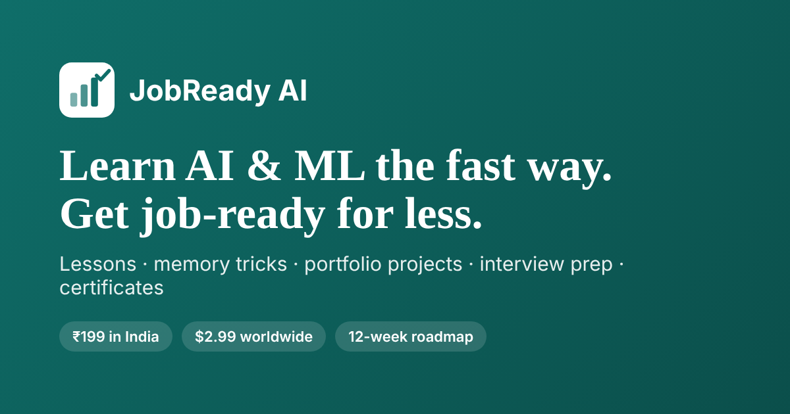

# JobReady AI

Learn AI & machine learning the fast way and get job-ready for less.

**▶ Open the app: https://ajinkyarodge66.github.io/jobready-ai/**

JobReady AI is the international edition of [IDTA Revision](https://ajinkyarodge66.github.io/idta-revision/). Both share the same accounts, so you can log in to either with the same mobile number and password.

## What's inside

| Section | What you get |
|---|---|
| **Learn** | **38 lessons in three levels.** *Foundation* (26 lessons: data, classic ML, neural networks, NLP, generative AI, MLOps). *Professional* (linear algebra, probability & statistics, A/B testing, training deep networks, computer vision, transformers step by step). *Advanced* (LLM internals, fine-tuning & RAG evaluation, AI agents & safety, data pipelines & SQL, deployment & monitoring, ML system design). Each lesson has worked examples, code and a quick check. A study coach adds a daily goal, streaks, spaced-repetition reviews and an exam countdown |
| **Career hub** | A **marked capstone project** (100-point rubric, Pass/Merit/Distinction certificate), a **12-week roadmap** to job-ready, **5 portfolio projects** (churn prediction, house prices, customer segmentation, sentiment analysis, a RAG question-answering bot), **35 interview questions with model answers**, and **memory tricks and cheat sheets** for every topic |
| **Practice** | 190+ exam-style questions with instant explanations, plus My mistakes and spaced-repetition reviews |
| **Calc Lab** | Unlimited calculation drills with worked solutions |
| **Mock exam** | Foundation Papers 1–3 and a random exam, the **Professional** and **Advanced** exams, topic tests and quick mocks, with a camera check, results by topic, and a verifiable certificate at 70%+ |
| **Refer & earn** | £1 for every friend who joins with your link, unlocks the exams and studies on 10 different days |

Lessons, practice, Calc Lab, flashcards, the study coach and the Career hub are free. Timed exams and certificates unlock with a small one-off fee in your local currency (for example ₹199 in India, $3.99 in the USA and Canada, €3.49 in Europe, $2.99 elsewhere). You can get a full refund any time before you start your first exam.

It works on phones and laptops, and offline once loaded. Use **Add to Home Screen** to install it like an app.

## Privacy

See [privacy.html](privacy.html). There are no ads and no third-party trackers.

## Found a mistake?

[Open an issue](https://github.com/Ajinkyarodge66/jobready-ai/issues) with the question and what you think the right answer is.
